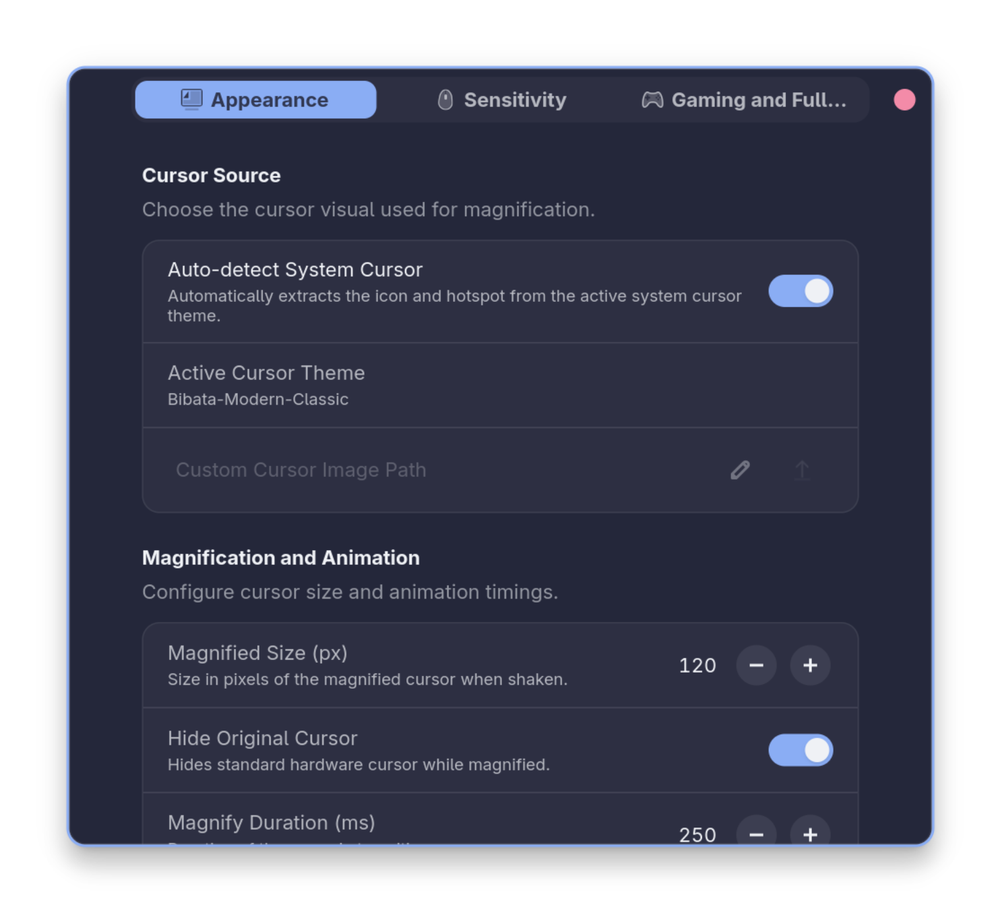
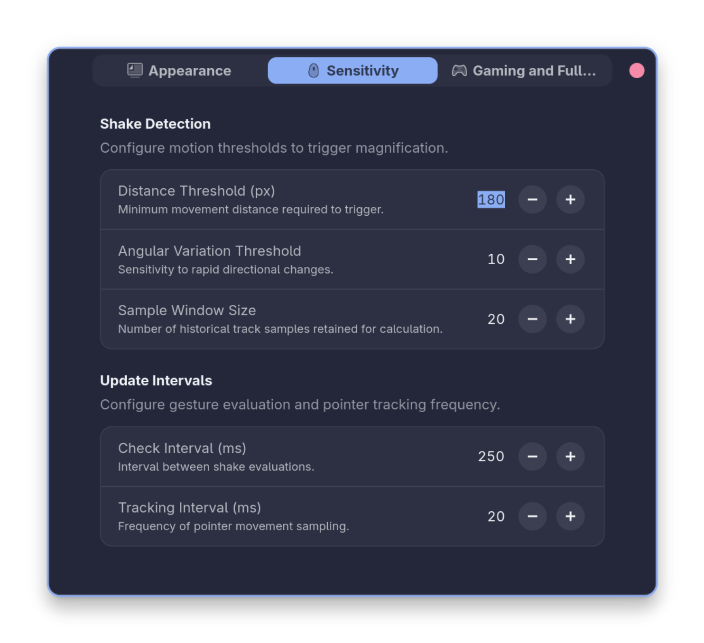
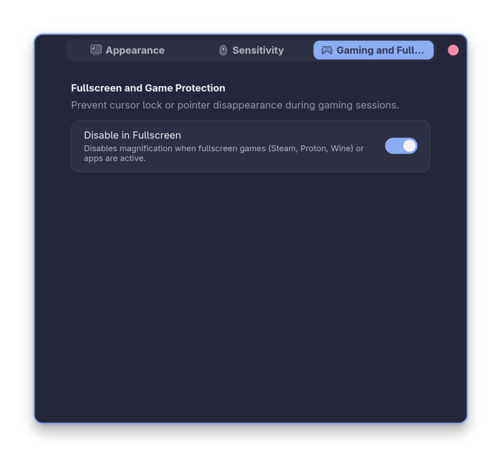

# Waggle

Magnify the mouse cursor by shaking it rapidly.


## Features

- **Auto Cursor Detection**: Matches your active cursor theme (Adwaita, Bibata, Breeze, etc.)
- **Smooth Animation**: Cubic easing with real-time pointer tracking
- **Gaming Protection**: Automatically disabled in fullscreen games and window drags
- **Libadwaita UI**: Clean, native preferences window
- **GNOME 46–51**: Full Wayland and X11 support

## Preview

<p align="center">
  
  
  
</p>

## Installation

```bash
git clone https://github.com/lexp-hub/waggle.git ~/.local/share/gnome-shell/extensions/waggle@lex
glib-compile-schemas ~/.local/share/gnome-shell/extensions/waggle@lex/schemas/
gnome-extensions enable waggle@lex
```

*Restart GNOME Shell or log out and back in on Wayland.*

## License

[GPL-3.0](LICENSE.txt)
